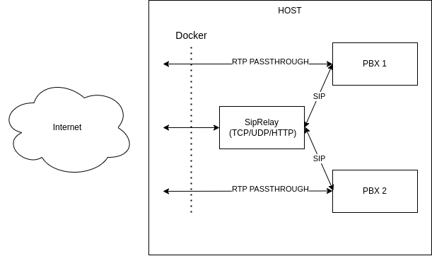

# SIPRelay

SIPRelay is a TypeScript SIP proxy that sits between phones or connections and Docker-hosted
Asterisk or other PBXs. Docker labels supply the PBX routing table automatically as containers
start and stop. SIP signalling supports UDP, TCP and TLS. SDP passes through unchanged;
RTP/audio travels between endpoints or through a separately configured media proxy.

**Status: in development, suitable for controlled staging.** Local Asterisk signalling and
multi-PBX routing checks pass, but real mobile wake-up, sustained load and recovery testing
remain production gates. SIPRelay implements selected SIP standards and an app-specific push
flow; complete RFC 3261/RFC 8599 conformance and high availability are not claimed.

## Features and call flow

- Automatic PBX discovery from Docker labels, including separate domains with overlapping extensions.
- Stateful SIP transactions, retransmission handling, response matching and dialog-flow protection.
- Multiple accepted Contact bindings per account in the default Path registration mode.
- Native Apple APNs VoIP and Google FCM push for your own mobile application.
- Configurable memory, SQLite or MySQL storage for accepted push-device registrations.
- A dashboard and JSON endpoints for discovered routes, liveness and storage readiness.

For a normal registration or call:

1. Docker discovery maps a labelled SIP domain to a PBX address and transport port.
2. SIPRelay forwards the phone's request to that PBX. The PBX authenticates and authorizes the account.
3. In default `path` mode, REGISTER Contacts remain intact and SIPRelay adds a signed Path route.
4. Only a matching successful PBX REGISTER response creates or refreshes an accepted binding.
5. Incoming PBX requests use the recorded route and device flow. Responses are matched to
   their transaction, expected peer and proxy Via branch before forwarding.

For an initial INVITE to a supported push-enabled device, SIPRelay sends a push and holds the
call for up to 25 seconds. The app wakes, reconnects and completes an authenticated REGISTER;
SIPRelay then delivers the held INVITE. The accepted refresh must match the tenant, user and
push destination. CANCEL prevents later delivery; timeout returns 480 and provider failure 503.
The phone and PBX must use the same transport for this delivery path.



## Quick start with Docker Compose

Run from the repository root on a Linux Docker host. The root [Compose file](docker-compose.yml)
builds SIPRelay and provides a persistent `/data` volume. It does not create a PBX. For a
complete local Asterisk project, use the [isolated izPBX lab](examples/izpbx-lab/README.md).

Find the Docker socket group ID:

```bash
stat -c '%g' /var/run/docker.sock
```

Create or update a local `.env` with that number and the address phones/PBXs can actually use
to reach SIPRelay. The address below is a documentation placeholder; replace it:

```dotenv
DOCKER_SOCK_GID=123
PROXY_IP=192.0.2.10
PUSH_STORAGE=sqlite
```

Create `compose.local.yml` to forward the advertised address into the container:

```yaml
services:
  siprelay:
    environment:
      PROXY_IP: ${PROXY_IP:?Set PROXY_IP to the reachable relay address}
```

Then build and start:

```bash
docker compose -f docker-compose.yml -f compose.local.yml up -d --build siprelay
docker compose -f docker-compose.yml -f compose.local.yml logs --tail=100 siprelay
curl --fail http://127.0.0.1:8080/api/ready
curl --fail http://127.0.0.1:8080/api/routes
```

The default publications are UDP/TCP 5060, TLS 5061 and HTTP on host loopback 8080. TLS starts
only when both configured key and certificate files exist. Use the default unencrypted listeners
only in an isolated lab; configure validated TLS before exposing phones to an untrusted network.
An empty route list is expected until a labelled, reachable PBX is discovered.

**Compose `.env` values are used for interpolation.** The root Compose file forwards the storage
settings and selected SIP settings through `environment`. Other application variables listed
below must also be added to a service's `environment` or explicitly supplied through `env_file`.
Setting an arbitrary variable in the host `.env` alone does not pass it to the image.

Keep local environment/override files private and out of commits. Docker socket access is
privileged even with a `:ro` mount; production deployments should restrict discovery to the
list, inspect and event operations it needs through an isolated authorization layer/API proxy.

## PBX discovery and registration

Add labels to an existing PBX service, using its actual internal listening ports:

```yaml
labels:
  sip-proxy-host: pbx-a.example.com
  sip-proxy-port-udp: "5060"
  sip-proxy-port-tcp: "5060"
  sip-proxy-port-tls: "5061"
  sip-proxy-tls-server-name: pbx-a.example.com
```

| Label | Requirement | Meaning |
| --- | --- | --- |
| `sip-proxy-host` | Required | SIP domain handled by this PBX. |
| `sip-proxy-port-udp` | Optional | Internal UDP SIP port. |
| `sip-proxy-port-tcp` | Optional | Internal plain TCP SIP port. |
| `sip-proxy-port-tls` | Optional | Internal TLS SIP port. |
| `sip-proxy-tls-server-name` | Optional | Expected upstream TLS certificate DNS identity/SNI, separate from the Docker IP. |
| `sip-proxy-ip` | Optional | Explicit reachable PBX address override; use the actual numeric peer IP for inbound PBX source matching. |

At least one valid port label is required. The relay and PBX need network connectivity; join
a shared Docker network or provide an explicitly reachable address. For PBXs with multiple
networks, check `/api/routes` to confirm discovery selected a reachable interface. Configure SIP
domain DNS so phones connect through the relay. Labels discover routes; they do not provision
SIP accounts, passwords, dial plans, trunks or inbound routes.

`SIP_REGISTRATION_MODE=path` is the default. Phones must advertise `Supported: path`, and the
registrar must store and use Path routes. For Asterisk PJSIP, enable `support_path=yes` on the
AOR and verify the actual endpoint configuration; the lab demonstrates a tested setup. The PBX
must authenticate REGISTER and initial call requests, authorize the claimed account, preserve
Contact/Path routing and honor Record-Route. A binding REGISTER without UA Path support receives
421 with `Require: path`.

Use `SIP_REGISTRATION_MODE=contact` for legacy Contact rewriting while migrating. That mode
retains stricter Contact/account username restrictions. See the [standards review](docs/standards-review.md)
for the supported routing profile and remaining protocol work.

## SIP, TLS and HTTP configuration

These are application environment variables; paths refer to files **inside the container**.
If listener ports change, update Docker publications and network rules accordingly.

| Variable | Default | Meaning |
| --- | --- | --- |
| `PROXY_IP` | `127.0.0.1` | Reachable advertised relay IP/hostname for Via, Record-Route and Path; also Contact in legacy mode. |
| `SIP_REGISTRATION_MODE` | `path` | `path` or legacy `contact`. |
| `SIP_UDP_ENABLED` | `1` | `0` disables UDP. |
| `SIP_UDP_PORT` | `5060` | UDP listener port. |
| `SIP_TCP_ENABLED` | Follows `SIP_UDP_ENABLED` when unset | `0` disables plain TCP. |
| `SIP_TCP_PORT` | `5060` | Plain TCP listener port. |
| `SIP_TLS_PORT` | `5061` | TLS listener port; enabled when both key/certificate files exist. |
| `SIP_TLS_KEY_PATH` | `/ssl/server.key` | Relay TLS private key. |
| `SIP_TLS_CERT_PATH` | `/ssl/server.crt` | Relay TLS certificate/chain. |
| `SIP_TLS_CA_PATH` | Empty | Optional PEM CA bundle for upstream PBX verification; otherwise Node's trust store. |
| `SIP_TLS_REJECT_UNAUTHORIZED` | `1` | Upstream certificate verification; keep enabled in production. |
| `HTTP_PORT` | `8080` | Dashboard/API listener port. |
| `HTTP_CORS_ORIGINS` | Empty | Comma-separated allowed browser origins; CORS does not authenticate access. |
| `LOG_LEVEL` | `info` | `error`, `warn`, `info` or `debug`. |
| `MEDIA_MODE` | `passthrough` | Only supported value; other values fail startup. |

For TLS-only operation, update `compose.local.yml` with these entries and the real certificate
mounts, retaining its `PROXY_IP` entry:

```yaml
services:
  siprelay:
    environment:
      PROXY_IP: ${PROXY_IP:?Set PROXY_IP to the reachable relay address}
      SIP_UDP_ENABLED: "0"
      SIP_TCP_ENABLED: "0"
      SIP_TLS_REJECT_UNAUTHORIZED: "1"
      SIP_TLS_CA_PATH: /ssl/pbx-ca.crt
    volumes:
      - /srv/siprelay/ssl/server.key:/ssl/server.key:ro
      - /srv/siprelay/ssl/server.crt:/ssl/server.crt:ro
      - /srv/siprelay/ssl/pbx-ca.crt:/ssl/pbx-ca.crt:ro
```

Use your actual host file paths and grant the image's non-root user read access. The PBX CA
entry/mount is optional when the upstream certificate already chains to a trusted root.
Remove the UDP/TCP 5060 publications from the base Compose file and close those firewall ports.
Compose merges port lists, so merely omitting 5060 from an overlay does not remove a base publication.
Phones must validate the relay certificate; the relay must validate upstream PBX certificates.
Inbound PBX connections still rely on discovered source identity, so isolate the backend network.

SIP TLS protects signalling. Configure and verify SRTP/DTLS-SRTP at the actual endpoints or
an external media relay to protect audio. SIPRelay does not anchor RTP, perform ICE/TURN,
rewrite SDP or remove the need to configure media NAT/firewall traversal.

## Push-device storage

| Variable | Default | Meaning |
| --- | --- | --- |
| `PUSH_STORAGE` | `memory` | `memory`, `sqlite` or `mysql`; unknown values fail startup. |
| `PUSH_SQLITE_PATH` | `/data/push.sqlite` | Persistent SQLite file; `:memory:` is rejected for this backend. |
| `PUSH_MYSQL_HOST` | `localhost` | Database hostname; TLS requires a DNS name rather than an IP literal. |
| `PUSH_MYSQL_PORT` | `3306` | Database port. |
| `PUSH_MYSQL_DATABASE` | `siprelay` | Existing database name. |
| `PUSH_MYSQL_USER` | `siprelay` | Database user. |
| `PUSH_MYSQL_PASSWORD` | Empty | Database password. |
| `PUSH_MYSQL_TLS` | `1` | Verified database TLS; `0` is available for an isolated local lab. |
| `PUSH_MYSQL_CA_PATH` | Empty | Optional mounted private database CA; otherwise system trust. |

For SQLite, set `PUSH_STORAGE=sqlite` in `.env`; the root Compose file already mounts a named
volume at `/data`. For MySQL, set the following in `.env`; the root Compose file forwards them:

```dotenv
PUSH_STORAGE=mysql
PUSH_MYSQL_HOST=mysql.example.internal
PUSH_MYSQL_PORT=3306
PUSH_MYSQL_DATABASE=siprelay
PUSH_MYSQL_USER=siprelay
PUSH_MYSQL_PASSWORD='replace-with-a-secret'
PUSH_MYSQL_TLS=1
```

Create the dedicated database/user first; SIPRelay creates its tables. For a database service
on the same Docker network, use its service name and a certificate valid for that name.
`localhost` inside SIPRelay refers to the relay container. Mount a private CA if needed and
set its container path through `PUSH_MYSQL_CA_PATH`. No database server is included in the root
Compose project. See the [storage guide](docs/push-storage.md) for privileges, permissions and backups.

SQLite/MySQL preserve unexpired accepted push bindings and the private route signing key.
Restored devices are dormant: they must complete a fresh accepted REGISTER before call delivery.
Original expiry is preserved. Live sockets, transactions, dialogs and held calls remain in memory.
Writes are asynchronous, so an abrupt crash/outage can lose recent updates, including unregisters.
Startup waits for storage and fails on initialization/corruption errors. Failed writes retry and
make readiness return 503. SIGINT/SIGTERM flush storage with a ten-second deadline; full SIP call
draining is not implemented. Each database/file belongs to one running relay; shared MySQL does
not provide clustering. Backend changes do not migrate records automatically.

The [storage factory](src/store/persistence/createPushStorage.ts) selects adapters implementing
`PushStorage`; additional backends can be added without changing SIP/push coordination. See
[architecture](docs/architecture.md) and [storage validation](docs/push-storage-results.md).

## Apple and Google mobile push

The server needs an Apple APNs authentication `.p8` key with its Key ID, Team ID and VoIP topic,
and/or a Firebase service-account JSON key with permission to send FCM messages. The Firebase
server key file is different from the Android app's `google-services.json`. Device tokens come
from the app's SIP registration; do not put individual phone tokens in Compose.

| Variable | Default | Meaning |
| --- | --- | --- |
| `PUSH_APNS_KEY_PATH` | Empty | Mounted APNs `.p8` signing key. |
| `PUSH_APNS_KEY_ID` | Empty | Apple signing Key ID. |
| `PUSH_APNS_TEAM_ID` | Empty | Apple Developer Team ID. |
| `PUSH_APNS_TOPIC` | Empty | VoIP topic, normally the app bundle ID plus `.voip`. |
| `PUSH_APNS_SANDBOX` | `0` | Set `1` for sandbox device tokens; otherwise production APNs. |
| `PUSH_FCM_SERVICE_ACCOUNT_PATH` | Empty | Mounted Firebase service-account JSON containing `project_id`, `client_email` and `private_key`. |

The root Compose file does not yet forward push-provider variables. To configure both providers,
create `compose.push.yml` and replace the example IDs/topic with your own. Remove an unused
provider's entries and mount when configuring just one:

```yaml
services:
  siprelay:
    environment:
      PUSH_APNS_KEY_PATH: /run/secrets/apns.p8
      PUSH_APNS_KEY_ID: "YOUR_APPLE_KEY_ID"
      PUSH_APNS_TEAM_ID: "YOUR_APPLE_TEAM_ID"
      PUSH_APNS_TOPIC: "com.yourcompany.phone.voip"
      PUSH_APNS_SANDBOX: "0"
      PUSH_FCM_SERVICE_ACCOUNT_PATH: /run/secrets/firebase-service-account.json
    volumes:
      - /srv/siprelay-secrets/apns.p8:/run/secrets/apns.p8:ro
      - /srv/siprelay-secrets/firebase-service-account.json:/run/secrets/firebase-service-account.json:ro
```

Create the real credential files outside the repository, grant the non-root container user read
access, and then apply the overlays:

```bash
docker compose -f docker-compose.yml -f compose.local.yml -f compose.push.yml up -d --build siprelay
```

Providers stay unconfigured when their required settings are absent. The implementation selects
fixed endpoints; no provider URL variables or extra inbound ports are required. Allow outbound
HTTPS on TCP 443 to `api.push.apple.com` (production), `api.sandbox.push.apple.com` (development),
`oauth2.googleapis.com` (Google authentication) and `fcm.googleapis.com` (FCM delivery).
The current configuration supports one APNs topic/environment and one Firebase project per relay.

The app must include these URI parameters in its REGISTER Contact and subsequent refreshes:

| Parameter | iOS | Android |
| --- | --- | --- |
| `pn-provider` | `apns` | `fcm` |
| `pn-param` | `YOUR_TEAM_ID.com.yourcompany.phone.voip` | Firebase project ID |
| `pn-prid` | Hexadecimal PushKit VoIP device token | FCM device token |

URI-encode parameter values. iOS must integrate PushKit and CallKit and report incoming calls
promptly; Android must handle high-priority FCM and display the incoming-call experience. Both
apps must reconnect, authenticate and refresh registration using the same SIP transport before
the held call can be delivered. The payload includes `event=incoming_call`, `call_id` and
`call_uuid`. Token changes require an updated registration; unregister removes the accepted binding.
See the [mobile push guide](docs/flexisip-review.md) for complete Contact examples and protocol limits.

Provider acceptance does not establish real-device delivery. Physical locked/background phone
checks, including registration expiry while asleep, remain required with your app and credentials.

## Dashboard and API

| Endpoint | Behaviour |
| --- | --- |
| `GET /` | Dashboard of discovered PBX routes. |
| `GET /api/health` | Liveness: HTTP 200 with `status: "ok"` and a message. |
| `GET /api/ready` | Storage initialization/write health: HTTP 200 with `status: "ready"`, or 503 with `status: "degraded"`. |
| `GET /api/routes` | JSON `total` and `routes`, including host, IP and UDP/TCP/TLS ports. |

Readiness currently covers storage health. Docker discovery freshness, listener health, PBX
reachability and mobile push delivery require separate checks. An idle database outage becomes
visible when a storage operation fails. The root Compose healthcheck uses the liveness endpoint.

The dashboard/API have no built-in authentication. Keep HTTP private; the root Compose file
publishes it only on `127.0.0.1:8080`. Add authenticated HTTPS access if using a reverse proxy.
CORS does not restrict non-browser access.

## Development and validation

Use Node.js **22.13 or newer**. SQLite uses Node's built-in API, which is experimental on Node 22.

```bash
npm ci --ignore-scripts
npm run typecheck
npm run build
npm run test:coverage
```

`npm run typecheck` checks production code and tests. The build copies views/images into `dist/`;
run `node dist/server.js` to start locally with your environment and Docker access. `npm test`
runs without coverage, and `npm run test:watch` watches changes. Coverage thresholds are
99% statements/lines/functions and 93% branches; the HTML report is `coverage/index.html`.
Unit tests use fake transports/providers and temporary SQLite files; they require no live
PBX, Docker daemon or APNs/FCM credentials. Real-backend checks are separate.

Validation evidence includes local Asterisk 20.21.0 signalling over UDP/TCP/verified TLS,
two-PBX tenant routing with overlapping users and matching Call-IDs, Docker stop/start discovery,
and SQLite/MySQL persistence recovery. See the dated reports for the exact scenarios and limits:

- [Testing commands and coverage](docs/testing.md).
- [Asterisk interoperability results](docs/interop-results.md).
- [Two-PBX isolation results](docs/multi-pbx-results.md).
- [Push storage validation results](docs/push-storage-results.md).

The [izPBX lab](examples/izpbx-lab/README.md) is the reproducible PBX test project. Additional
Traefik/MikoPBX examples are in [examples/](examples/); those deployments have different ports,
networks and environment forwarding and are not interchangeable with the root Compose setup.

## Production readiness and CI

Before public production use, complete real phone push testing, SIPp/load/soak and packet-fault
scenarios, encrypted media/NAT validation, backup/restore and deployment rollback exercises.
Graceful call draining, broader operational metrics/readiness and Docker event-stream recovery
also need work. Persistent tokens alone do not make calls survive relay restarts.

The implementation still has protocol limits: cross-transport delivery, complete SIP Outbound,
full RFC 8599 negotiation/proactive registration refresh, general route/DNS failover processing,
early NOTIFY handling and comprehensive SIP conformance testing remain incomplete. Configure
and test a supported deployment profile rather than assuming arbitrary PBX/UA compatibility.
PBX authorization, trusted backend networks, restricted Docker access, validated signalling TLS
and endpoint/media-relay encryption are required parts of call protection.

The existing [GitHub Actions workflow](.github/workflows/docker-publish.yml) is configured to
publish `latest` on both PR and `master` push events. PR validation must be separated from release
publishing and production credentials before relying on it as a release gate. A Jenkins pipeline,
required PR checks and branch protection have been discussed but are not implemented here.
The intended checks include type checking, coverage, builds/scans and isolated multi-PBX/storage
integration tests, with credentialed mobile tests and longer soak runs on trusted staging agents.

Review the [security requirements](docs/security-review.md), [standards gaps](docs/standards-review.md)
and [architecture](docs/architecture.md) before deployment or extending the implementation.
